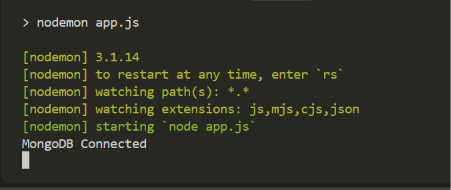
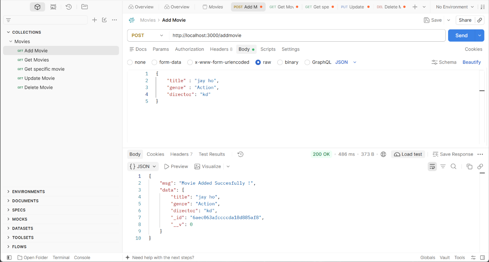
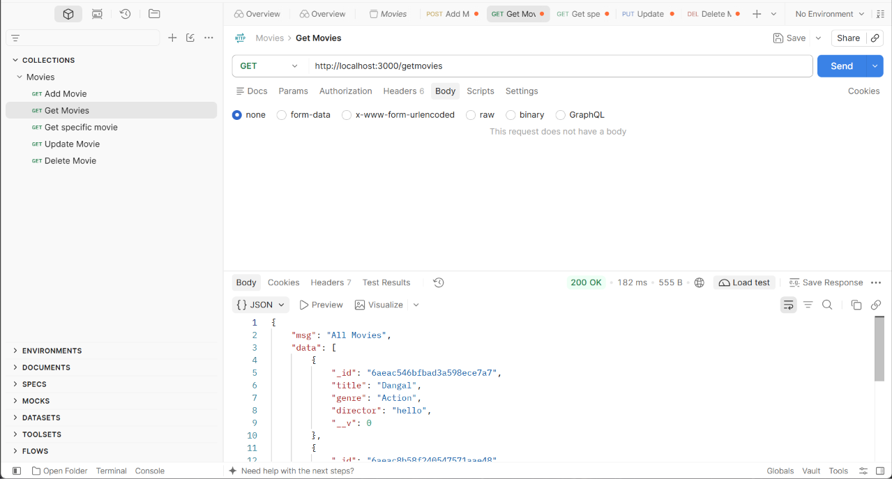
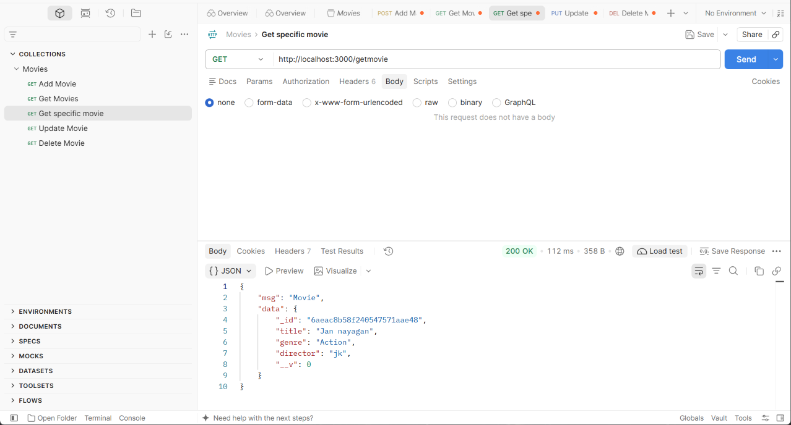
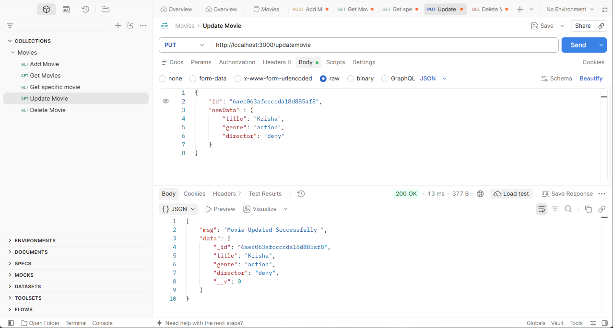
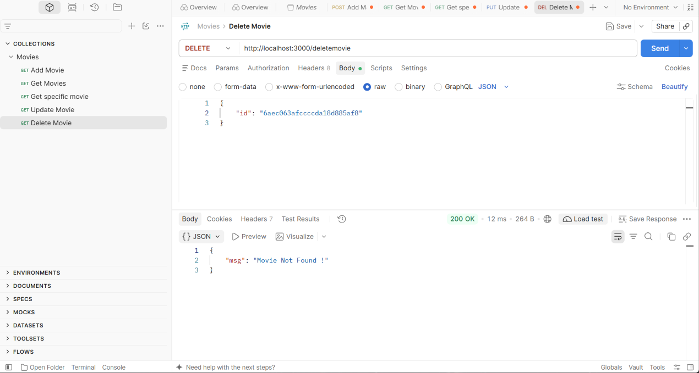
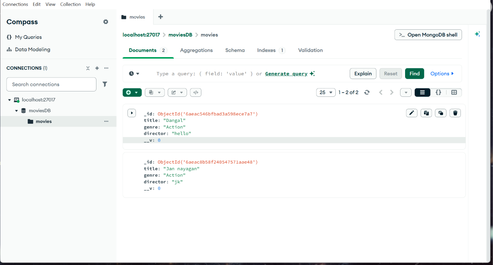

# 🎬 Movies API

A simple REST API project built using Node.js, Express.js, MongoDB, and Mongoose.

This project performs CRUD operations (Create, Read, Update, Delete) on movie data.

## 🚀 Technologies Used

* Node.js
* Express.js
* MongoDB
* Mongoose

## 📌 Features

1. Add Movie
2. Get All Movies
3. Get Specific Movie
4. Update Movie
5. Delete Movie

## ⚙️ Installation

Install the required packages:

```bash
npm install express mongoose
```

Add the following in `package.json`:

```json
{
  "type": "module"
}
```

## ▶️ Run Project

```bash
node server.js
```

Server runs at:

```text
http://localhost:3000
```

## 🗄️ Database Connection

Database Name: `moviesDB`

MongoDB Connection:

```text
mongodb://127.0.0.1:27017/moviesDB
```

## 📋 Movie Schema

| Field    | Data Type |
| -------- | --------- |
| title    | String    |
| genre    | String    |
| director | String    |

## 🔗 API Endpoints

### 1. Home Page

* Method: GET
* URL: `/`

Response:

```json
{
  "msg": "Home Page"
}
```

### 2. Add Movie

* Method: POST
* URL: `/addmovie`

Request Body:

```json
{
  "title": "Jan Nayagan",
  "genre": "Action",
  "director": "H. Vinoth"
}
```

Response:

```json
{
  "msg": "Movie Added Successfully!"
}
```

### 3. Get All Movies

* Method: GET
* URL: `/getmovies`

Description: Retrieves all movies from the database.

### 4. Get Specific Movie

* Method: GET
* URL: `/getmovie`

Description: Retrieves a movie with the title "Jan nayagan".

### 5. Update Movie

* Method: PUT
* URL: `/updatemovie`

Request Body:

```json
{
  "id": "your_movie_id",
  "newData": {
    "title": "Jan Nayagan",
    "genre": "Drama",
    "director": "H. Vinoth"
  }
}
```

### 6. Delete Movie

* Method: DELETE
* URL: `/deletemovie`

Request Body:

```json
{
  "id": "your_movie_id"
}
```
##🎬Demo video
[Watch Demo Video](https://drive.google.com/drive/folders/162A1xxfnEdrPRRQmOGFzX8zNcDA3X6se)

##📷 Screenshoots








## 🧪 Testing

You can test all API endpoints using Postman.

For POST, PUT, and DELETE requests, select:

**Body → raw → JSON**

## 👨‍💻 Author

Movies API Project

---

⭐ Thank you for visiting my project!
